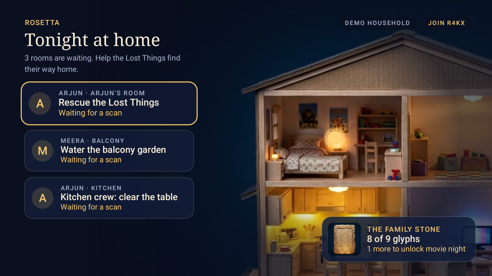
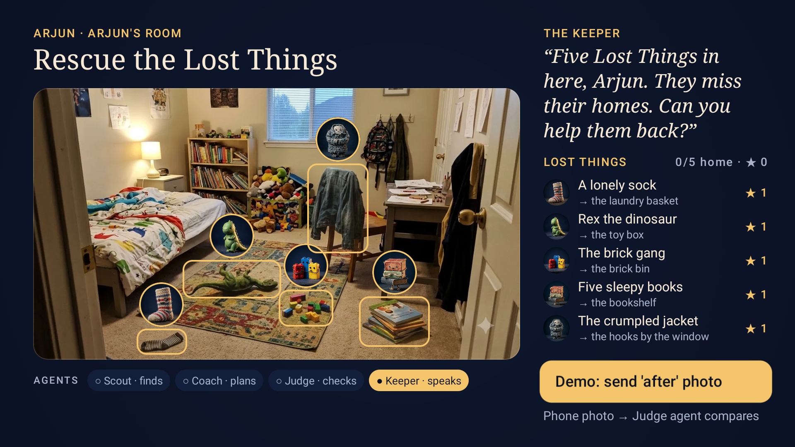
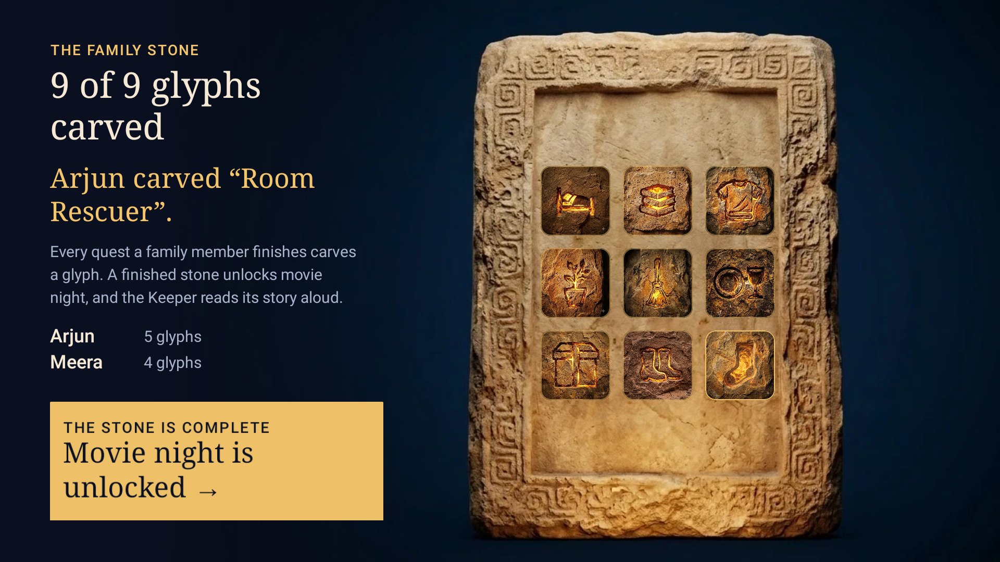

# Project Rosetta

**The Fire TV app that translates "clean your room" into an adventure.**

An AI agent crew looks at a photo of a child's room, turns the mess into **Lost Things** (shy little characters
who miss their homes), checks the "after" photo item by item, and carves a glyph into the family's **Family Stone**.
A finished stone unlocks movie night. The TV, the biggest shared screen in the home, finally works *for* the family
instead of being the prize everyone fights over.

> Built for the Amazon Developer **Build, Ship, Shape** hackathon · **Fire TV track** · AWS Builder + Open Source mini challenges.

| Home Base | Lost Things (Room Scan) | Family Stone |
|---|---|---|
|  |  |  |

## How it works

```
 Kid's phone / Fire tablet            AWS (us-east-1)                                   Fire TV (native Kotlin app)
 ┌───────────────────────┐ PUT photo ┌──────────────────────────────────────────────┐  poll  ┌───────────────────────────┐
 │ kid.html (QR from TV) │ ────────► │ S3 uploads/ (auto-delete after 1 day)        │ ◄───── │ Home Base (miniature home) │
 └───────────────────────┘           │   └─event─► Agent Lambda                     │        │ Room Scan: Lost Things     │
 ┌───────────────────────┐           │        Quest Master (Strands Agents)         │        │ Family Stone · Movie Night │
 │ parent.html           │ ────────► │        ├ Scout   find out-of-place items     │        │ Keeper voice (TTS)         │
 │ Mission Control       │  HTTP API │        ├ Coach   homes + stars per item      │        └───────────────────────────┘
 └───────────────────────┘           │        ├ Judge   before/after, confidence    │
                                     │        ├ Router  unsure → ask the parent     │
                                     │        └ Keeper  one warm spoken sentence    │
                                     │   Amazon Bedrock (Amazon Nova Pro, vision)   │
                                     │ API Lambda ── DynamoDB (household document)  │
                                     │ CloudFront ── phone pages                    │
                                     └──────────────────────────────────────────────┘
```

- **Fire TV app** (`tv-app/`): Kotlin, Jetpack Compose for TV (`androidx.tv:tv-material`), D-pad first, runs on Fire OS (minSdk 25).
- **Agent crew** (`agents/`): Python, [Strands Agents](https://strandsagents.com) on Amazon Bedrock. Quest Master decides which specialist to call; each specialist is a Bedrock Converse call with images and a forced JSON tool schema (grounded boxes in 0–1000 coordinates).
- **Infrastructure** (`infra/`): AWS CDK (TypeScript): S3, DynamoDB, Lambda ×2, API Gateway HTTP API, CloudFront.
- **Phone pages** (`web/`): plain HTML/JS. The kid scans the QR on the TV and takes a photo; the phone shrinks it and uploads it straight to S3.

## Run it

### 1. Fire TV app in demo mode (no AWS needed)
The app ships with a **demo household** that replays the agent crew's real states and timings from bundled assets,
so judges can try the whole flow with only a remote.

```bash
cd tv-app
./gradlew installDebug          # Fire TV device (adb connect <ip>:5555) or Android TV emulator
adb shell am start -n app.rosetta.tv/.MainActivity
```
Emulator used in development: `system-images;android-30;android-tv;x86` (Fire OS 8 is based on Android 11), 1080p.

Demo path with the remote: **OK** on "Rescue the Lost Things" → **OK** "Demo: send sample photo" → **OK** "send 'after' photo" →
**OK** "send final photo" → **OK** "Carve the glyph" → **OK** "Movie night is unlocked".

### 2. Live mode (agent crew on AWS)
Prerequisites: AWS account with Bedrock model access to **Amazon Nova Pro** in us-east-1, Node 20+, Python 3.12+.

```bash
python assets/build_assets.py            # copies art into the TV app and web/
python agents/build_lambda.py            # Linux bundle for Lambda (no Docker needed)
cd infra && npm install && npx cdk deploy
curl -X POST <ApiUrl>/household/R4KX/reset   # seed the demo household in DynamoDB
cd ../tv-app && ./gradlew installDebug -ProsettaApiUrl=<ApiUrl> -ProsettaWebUrl=<WebUrl>
```
Then open the quest on the TV and scan the QR with a phone. To use a Claude model instead: `npx cdk deploy -c modelId=<bedrock-model-id>`.

### 3. Tests
```bash
python -m unittest discover -s agents/tests     # offline flow: API + uploads + crew policy (stubbed vision)
python -m rosetta_agents.cli scout room.jpg     # (from agents/, needs Bedrock) try Scout on your own photo
```

## AWS integrations

| Service | What Rosetta uses it for | Code |
|---|---|---|
| Amazon Bedrock (Converse, Amazon Nova Pro) | Scout (find items + boxes), Judge (before/after verdict + confidence), Keeper (spoken line) | `agents/rosetta_agents/vision.py` |
| Strands Agents SDK | Quest Master agent orchestrating Scout/Judge/Router/Keeper as tools | `agents/rosetta_agents/crew.py` |
| AWS Lambda | API + agent crew (S3-triggered) | `agents/rosetta_agents/handlers.py`, `infra/lib/rosetta-stack.ts` |
| Amazon S3 | Photo uploads (presigned PUT, 1-day lifecycle), web hosting | `store.py`, `rosetta-stack.ts` |
| Amazon DynamoDB | Household document (quests, Lost Things, glyphs) | `store.py` |
| Amazon API Gateway (HTTP API) | TV + phone API | `rosetta-stack.ts` |
| Amazon CloudFront | HTTPS phone pages with the API URL injected | `rosetta-stack.ts` |
| AWS CDK | One-command infrastructure | `infra/` |

## Privacy and kids
- No kid accounts: a household is parent-managed; kids are a first name.
- Photos are deleted automatically after one day (S3 lifecycle); the TV caches only the current quest's photos.
- The Keeper is prompted never to shame, mock, or comment on a child's character. Mess becomes "Lost Things", not failure.
- Low-confidence verdicts go to a parent instead of auto-deciding.
- Rewards are earned, never random; no gambling-style mechanics.

## Repo map
| Path | |
|---|---|
| `tv-app/` | Fire TV app (Kotlin, Compose for TV) |
| `agents/` | Agent crew (Python, Strands, Bedrock) + offline tests |
| `infra/` | AWS CDK stack |
| `web/` | Kid and parent phone pages |
| `assets/flow/` | Original art generated in Google Flow (watermarks untouched) · `assets/build_assets.py` copies it into the apps |
| `PROJECT_ROSETTA.md` | Product spec, prior-art search, hackathon compliance map |
| `FRICTION_LOG.md` · `FEEDBACK.md` · `CREDITS.md` | Developer feedback, friction log, asset credits |

## License
MIT. See [LICENSE](LICENSE). AI-generated artwork: see [CREDITS.md](CREDITS.md).
