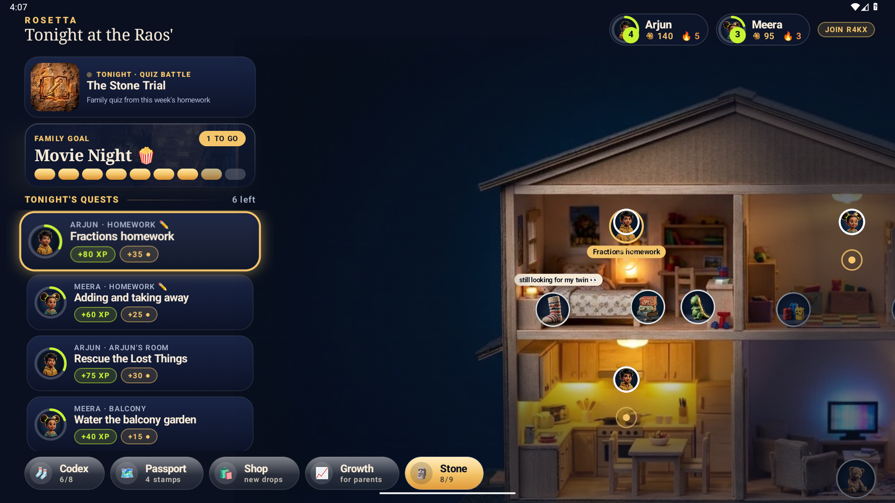
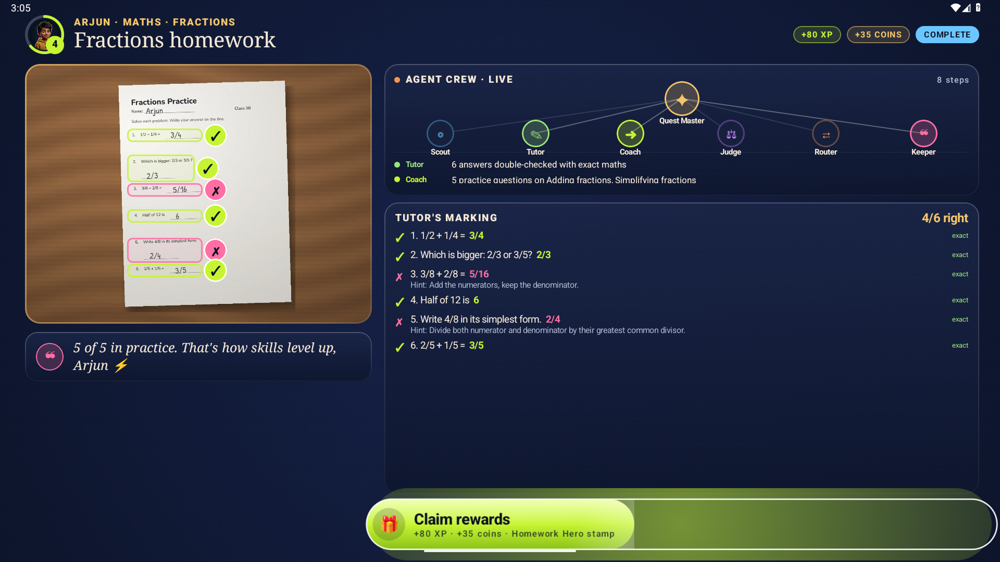
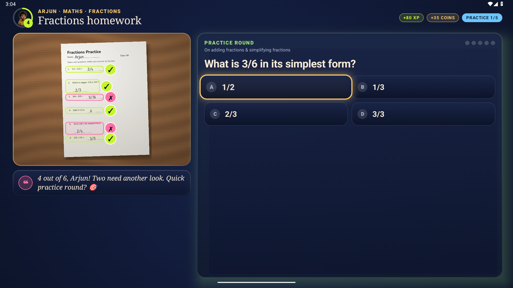
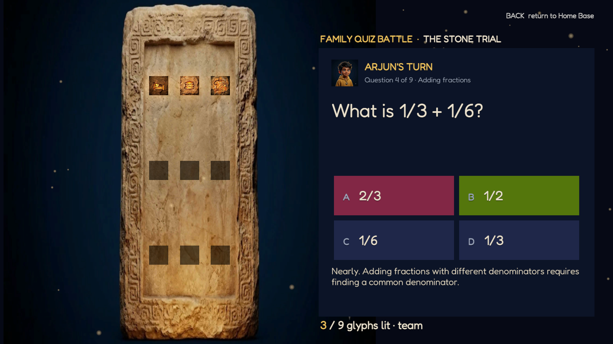
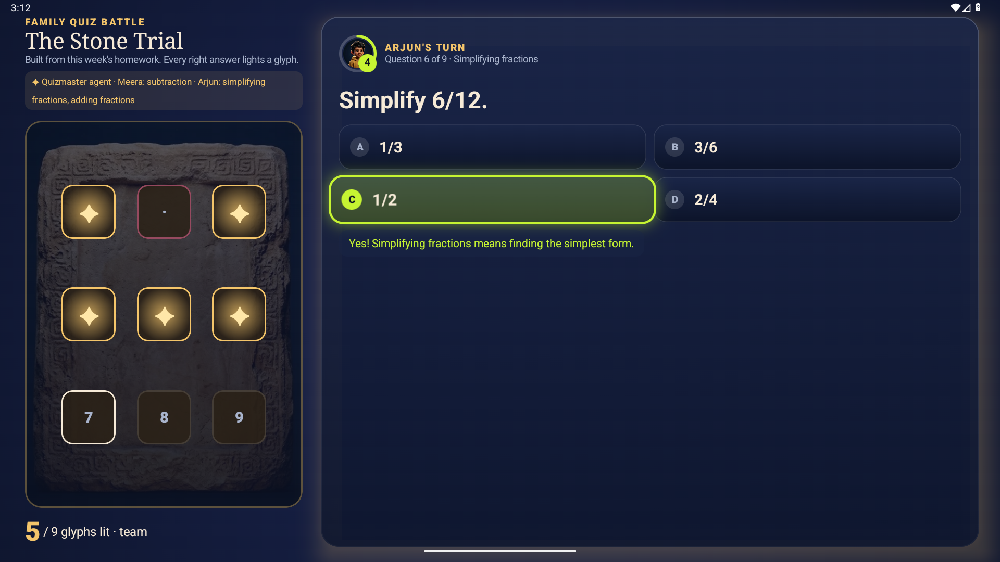
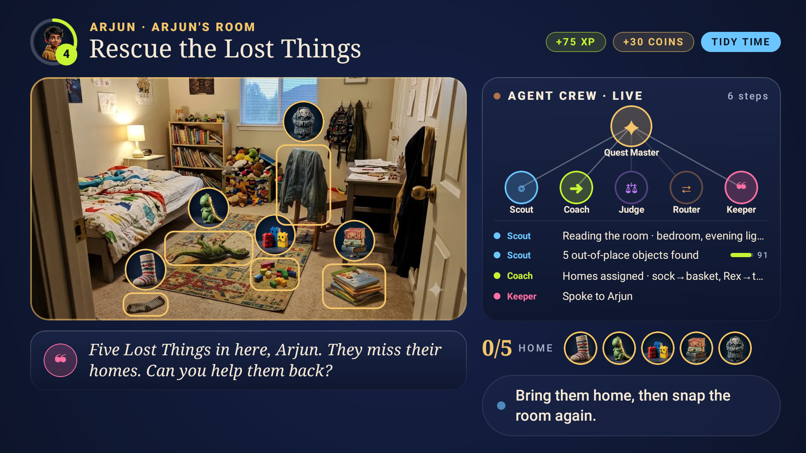

# Project Rosetta

**The Fire TV that turns homework and chores into a family adventure, with an AI tutor that never gives the answer away.**

Kids photograph their worksheet (or their room) with any phone. An AI agent crew on Amazon Bedrock reads it: the
**Tutor** marks every answer on the TV, with arithmetic double-checked in code and a hint (never the answer) for each
mistake; **Practice** builds a short round on exactly the skills that slipped; the **Quizmaster** turns the week's
homework into a co-op **Quiz Battle** that lights up the Family Stone in a Unity scene. The same crew turns a messy room
into **Lost Things** that need to go home. Every finished quest carves a glyph; a full stone unlocks Movie Night.
The TV, the biggest shared screen in the home, finally works *for* the family instead of being the prize everyone
fights over.

> Built for the Amazon Developer **Build, Ship, Shape** hackathon · **Fire TV track** · AWS Builder + Open Source mini challenges.

| Home Base | Homework Check | Practice |
|---|---|---|
|  |  |  |

| Stone Trial (Unity) | Quiz Battle | Lost Things (Room Scan) |
|---|---|---|
|  |  |  |

## What's inside

| Feature | What it does |
|---|---|
| **Homework Check** | Snap a worksheet; the Tutor agent marks each answer with a tick or cross drawn on the photo. Arithmetic is verified exactly in code (`mathcheck.py`); wrong answers get a method hint, never the answer. |
| **Practice** | Five fresh questions on exactly the skills that went wrong, validated in code (one right option, never a repeat of the homework). Answer with the remote or the phone. |
| **Quiz Battle: the Stone Trial** | A co-op family quiz the Quizmaster agent builds from this week's homework, pitched at each child. Right answers ignite glyphs on the Family Stone (Unity 6 scene, or native on the TV). No rankings. |
| **Home Base** | The family's house as a lit miniature. Rescued Lost Things live in its rooms and chat in bubbles; bought decor appears on it. |
| **Room Scan → Lost Things** | Scout finds what's out of place in a phone photo; each item becomes a stop-motion character pinned to the real object. |
| **Live agent Mission Control** | Watch Quest Master route work to Scout, Coach, Judge, Router and Keeper, with confidence scores. |
| **Rosetta Arena (Unity)** | Companion Unity 6 app: hosts the Stone Trial (bloom, particles, carved glyphs igniting). Launched from the TV with the quiz; answers sync back. Still contains the retired Mess Boss raid mode. |
| **Parent alerts** | Push, email or SMS: quest done, "please check" (PIN-protected approve/reject), streak at risk, weekly Digest written by an agent. |
| **Phone hype emotes** | Siblings send 🔥 💀 🫶 from their phones; they burst onto the TV (allow-listed, kid-safe). |
| **Progression** | Levels, XP, coins, streaks, reward reveal, passport stamps, Codex of collectibles whose rarity is earned, shop for outfits and house decor. |
| **Family Stone → Movie Night** | Every quest carves a glyph; a full stone unlocks movie night. |
| **Growth** | For parents: what's being learned and the recurring mistakes, quests/day, tidy-time trend, self-starts, and the agents' plain-language notes. |

## How it works

```
 Kid's phone / Fire tablet            AWS (us-east-1)                                   Fire TV (native Kotlin app)
 ┌───────────────────────┐ PUT photo ┌──────────────────────────────────────────────┐  poll  ┌───────────────────────────┐
 │ kid.html (QR from TV) │ ────────► │ S3 uploads/ (auto-delete after 1 day)        │ ◄───── │ Home Base (miniature home) │
 └───────────────────────┘           │   └─event─► Agent Lambda                     │        │ Room Scan: Lost Things     │
 ┌───────────────────────┐           │        Quest Master (Strands Agents)         │        │ Family Stone · Movie Night │
 │ parent.html           │ ────────► │        ├ Scout   find out-of-place items     │        │ Keeper voice (TTS)         │
 │ Mission Control       │  HTTP API │        ├ Coach   homes + stars per item      │        └───────────────────────────┘
 └───────────────────────┘           │        ├ Judge   before/after, confidence    │
                                     │        ├ Router  unsure → ask the parent     │
                                     │        └ Keeper  one warm spoken sentence    │
                                     │   Amazon Bedrock (Amazon Nova Pro, vision)   │
                                     │ API Lambda ── DynamoDB (household document)  │
                                     │ CloudFront ── phone pages                    │
                                     └──────────────────────────────────────────────┘
```

- **Fire TV app** (`tv-app/`): Kotlin, Jetpack Compose for TV (`androidx.tv:tv-material`), D-pad first, runs on Fire OS (minSdk 25).
- **Agent crew** (`agents/`): Python, [Strands Agents](https://strandsagents.com) on Amazon Bedrock. Quest Master decides which specialist to call; each specialist is a Bedrock Converse call with images and a forced JSON tool schema (grounded boxes in 0–1000 coordinates).
- **Infrastructure** (`infra/`): AWS CDK (TypeScript): S3, DynamoDB, Lambda ×2, API Gateway HTTP API, CloudFront.
- **Phone pages** (`web/`): plain HTML/JS. The kid scans the QR on the TV and takes a photo; the phone shrinks it and uploads it straight to S3.

## Run it

### 1. Fire TV app in demo mode (no AWS needed)
The app ships with the Rao household (two kids, a month of progress) so the experience is full on first launch.

```bash
cd tv-app
./gradlew installDebug          # Fire TV device (adb connect <ip>:5555) or Android TV emulator
adb shell am start -n app.rosetta.tv/.MainActivity
```
Emulator used in development: `system-images;android-30;android-tv;x86` (Fire OS 8 is based on Android 11), 1080p.

Without a deployed backend the TV runs its on-device household engine and waits for a phone. For testing without a phone,
two hidden developer keys stand in for it: **MENU** sends the bundled photo for that quest (a worksheet or the room;
the marking replayed is the real Nova Pro output recorded on that photo), and **FAST-FORWARD** sends a sibling emote.

Two-minute tour: open **Fractions homework** → MENU → the Tutor marks it 4/6 → five practice questions → Claim rewards →
carve the Homework Hero glyph (stone complete, Movie Night unlocks) → back on Home, Up to **Quiz Battle** → the Stone
Trial opens in the Unity arena if installed (natively otherwise).

### 2. Live mode (agent crew on AWS)
Prerequisites: AWS account with Bedrock model access to **Amazon Nova Pro** in us-east-1, Node 20+, Python 3.12+.

```bash
python assets/build_assets.py            # copies art into the TV app and web/
python agents/build_lambda.py            # Linux bundle for Lambda (no Docker needed)
cd infra && npm install && npx cdk deploy
curl -X POST <ApiUrl>/household/R4KX/reset   # seed the demo household in DynamoDB
cd ../tv-app && ./gradlew installDebug -ProsettaApiUrl=<ApiUrl> -ProsettaWebUrl=<WebUrl>
```
Then open the quest on the TV and scan the QR with a phone. The stack in our account is live at
`https://jlgtsqwtzl.execute-api.us-east-1.amazonaws.com` (phone page: `https://dr8w3l96syzm7.cloudfront.net/kid.html?code=R4KX`). To use a Claude model instead: `npx cdk deploy -c modelId=<bedrock-model-id>`.

### 3. Raid Arena (Unity, optional)
The TV app opens the boss fight in the companion Unity app when it is installed, and falls back to its native raid screen
otherwise. The source lives in `arena-unity/`; the scene is built entirely from code, so it builds headlessly.

```bash
bash arena-unity/sync.sh --build     # mirrors the source into a Unity 6 project and builds Builds/RosettaArena.apk
adb install -r /e/Unity/Projects/RosettaArena/Builds/RosettaArena.apk
```
APK targets ARM64 (Fire TV hardware) and x86_64 (emulators). On the raid, MENU stands in for a verified put-away and
BACK returns to Home Base with the new hits.

### 4. Tests
```bash
python -m unittest discover -s agents/tests     # offline flow: API + uploads + crew policy (stubbed vision)
python -m rosetta_agents.cli scout room.jpg     # (from agents/, needs Bedrock) try Scout on your own photo
```

## AWS integrations

| Service | What Rosetta uses it for | Code |
|---|---|---|
| Amazon Bedrock (Converse, Amazon Nova Pro) | Tutor (mark a homework photo, boxes + hints), Practice and Quizmaster (questions), Scout (find items + boxes), Judge (before/after verdict + confidence), Keeper (spoken line), Digest (weekly note) | `agents/rosetta_agents/tutor.py`, `vision.py` |
| Strands Agents SDK | Quest Master agent choosing tools per photo: mark_homework, make_practice, scout_room, check_after, ask_parent, complete_quest, keeper_says | `agents/rosetta_agents/crew.py` |
| Amazon EventBridge | Evening streak nudge and weekly Growth digest (scheduled Lambda) | `rosetta-stack.ts`, `handlers.scheduled` |
| Amazon SES / Amazon SNS / Web Push | Parent alerts by email, SMS (urgent only) and phone push (VAPID) | `agents/rosetta_agents/notify.py` |
| AWS Lambda | API + agent crew (S3-triggered) | `agents/rosetta_agents/handlers.py`, `infra/lib/rosetta-stack.ts` |
| Amazon S3 | Photo uploads (presigned PUT, 1-day lifecycle), web hosting | `store.py`, `rosetta-stack.ts` |
| Amazon DynamoDB | Household document (quests, Lost Things, glyphs) | `store.py` |
| Amazon API Gateway (HTTP API) | TV + phone API | `rosetta-stack.ts` |
| Amazon CloudFront | HTTPS phone pages with the API URL injected | `rosetta-stack.ts` |
| AWS CDK | One-command infrastructure | `infra/` |

## Privacy and kids
- No kid accounts: a household is parent-managed; kids are a first name.
- Photos are deleted automatically after one day (S3 lifecycle); the TV caches only the current quest's photos.
- The Keeper is prompted never to shame, mock, or comment on a child's character. Mess becomes "Lost Things", not failure.
- Low-confidence verdicts go to a parent instead of auto-deciding.
- Rewards are earned, never random; no gambling-style mechanics.

## Repo map
| Path | |
|---|---|
| `tv-app/` | Fire TV app (Kotlin, Compose for TV) |
| `arena-unity/` | Raid Arena companion app (Unity 6, URP, C#) |
| `agents/` | Agent crew (Python, Strands, Bedrock) + offline tests |
| `infra/` | AWS CDK stack |
| `web/` | Kid and parent phone pages |
| `assets/flow/` | Original art generated in Google Flow (watermarks untouched) · `assets/build_assets.py` copies it into the apps |
| `assets/homework/` | Demo worksheets rendered from code, their true answers, and the real Nova Pro outputs replayed by the offline demo |
| `HANDOFF.md` · `docs/history/` | Full project history, decisions and status for whoever continues the work |
| `PROJECT_ROSETTA.md` | Product spec, prior-art search, hackathon compliance map |
| `FRICTION_LOG.md` · `FEEDBACK.md` · `CREDITS.md` | Developer feedback, friction log, asset credits |

## License
MIT. See [LICENSE](LICENSE). AI-generated artwork: see [CREDITS.md](CREDITS.md).
