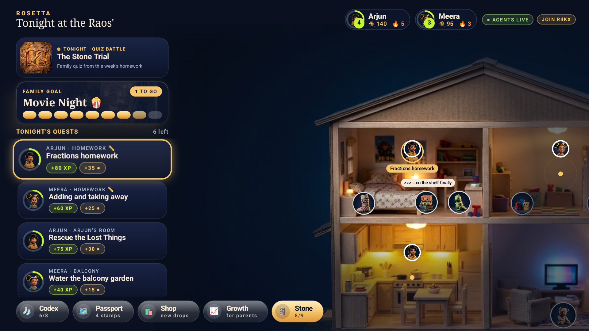
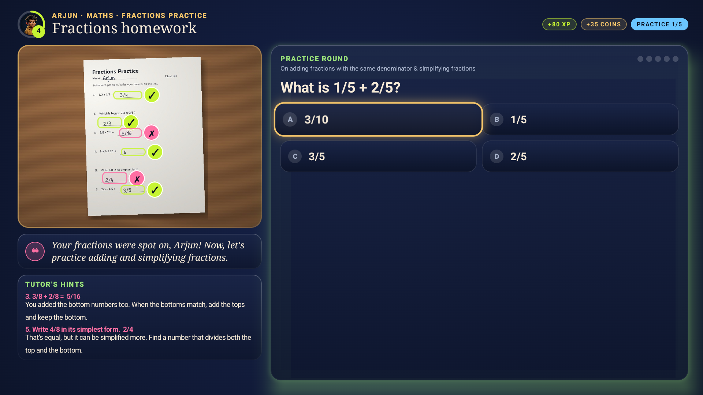
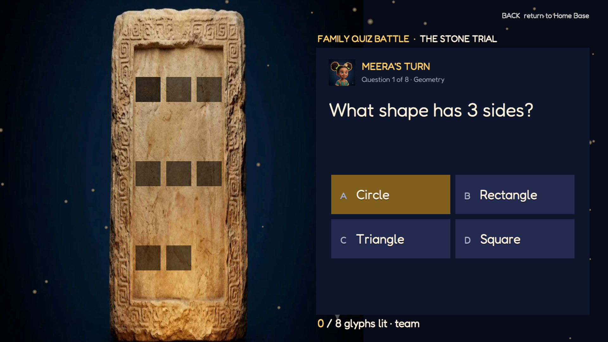
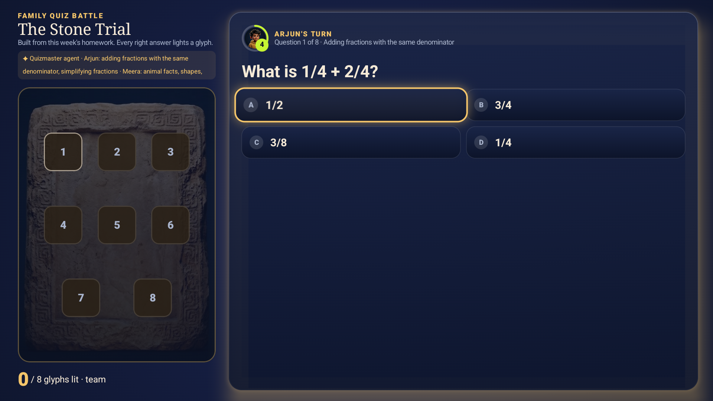
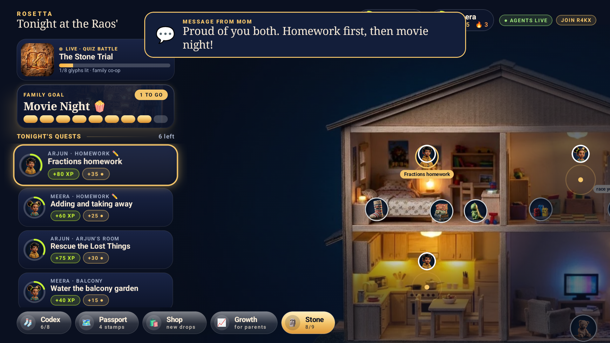

# Project Rosetta

**The Fire TV that turns homework and chores into a family adventure, with an AI tutor that never gives the answer away.**

Kids photograph their worksheet (or their room) with any phone. An AI agent crew running on AWS reads it: the
**Tutor** marks every answer on the TV, with arithmetic double-checked in code and a hint (never the answer) for each
mistake; **Practice** builds a short round on exactly the skills that slipped; the **Quizmaster** turns the week's
homework into a co-op **Quiz Battle** that lights up the Family Stone in a Unity scene. The **Keeper** narrates in a
warm storyteller voice, and Mom and Dad get alerts, approve what the AI isn't sure about, and send messages the TV reads
aloud. Every finished quest carves a glyph; a full stone unlocks Movie Night. The TV, the biggest shared screen in the
home, finally works *for* the family instead of being the prize everyone fights over.

> Built for the Amazon Developer **Build, Ship, Shape** hackathon · **Fire TV track** · AWS Builder + Open Source mini challenges.
> Open-source spin-off: [**compose-vision-overlay**](https://github.com/ashfaque-rifaye/compose-vision-overlay), the Compose for TV library that draws AI vision results.

All screenshots below are from the Android TV emulator configured as **Fire OS 16** (Android 16, API 36, 1080p, 320 dpi), running against the live AWS stack.

| Home Base (live) | Homework Check + Practice | Stone Trial (Unity) |
|---|---|---|
|  |  |  |

| Quiz Battle (native) | Message from Mom, read aloud | Lost Things (Room Scan) |
|---|---|---|
|  |  |  |

## What's inside

| Feature | What it does |
|---|---|
| **Homework Check** | Snap a worksheet; the Tutor agent marks each answer with a tick or cross drawn on the child's handwriting. Arithmetic is verified exactly in code (`mathcheck.py`), so the model reads and code decides; wrong answers get a method hint, never the answer. |
| **Practice** | Fresh questions on exactly the skills that went wrong, validated in code (one right option, never a repeat of the homework). Answer with the remote or the phone. |
| **Quiz Battle: the Stone Trial** | A co-op family quiz the Quizmaster agent builds from this week's homework, pitched at each child. Right answers ignite glyphs on the Family Stone (Unity 6 scene, or native on the TV). No rankings. |
| **The Keeper's voice** | Every line the TV speaks is a warm generated voice: live lines as they happen, repeating lines cached, offline lines bundled with the app. |
| **Live agent Mission Control** | Watch Quest Master route work to Tutor, Coach, Scout, Judge, Router and Keeper, with confidence scores. |
| **Parent Mission Control** | A phone page (installable PWA): PIN sign-in, approve or send back what the AI isn't sure about, the family feed, messages to the TV, posting quests, push / email / SMS alert settings. |
| **Home Base** | The family's house as a lit miniature. Rescued Lost Things live in its rooms and chat in bubbles; bought decor appears on it. |
| **Room Scan → Lost Things** | Scout finds what's out of place in a phone photo; each item becomes a stop-motion character pinned to the real object. |
| **Progression** | Levels, XP, coins, streaks, reward reveal, passport stamps, a Codex of collectibles, a shop for outfits and house decor. |
| **Family Stone → Movie Night** | Every quest carves a glyph; a full stone unlocks movie night. |
| **Growth** | For parents: what's being learned and the recurring mistakes, quests per day, trends, and the agents' plain-language notes. |

## How it works

```
 Kid's phone (any browser)            AWS us-east-1 (AWS CDK)                                Fire TV (native Kotlin app)
 ┌───────────────────────┐ PUT photo ┌───────────────────────────────────────────────────┐ poll ┌──────────────────────────┐
 │ kid.html (QR on TV)   │ ────────► │ S3 uploads/ (deleted after 1 day)                 │ ◄─── │ Home Base · quests       │
 └───────────────────────┘           │   └─event─► Agent Lambda: Quest Master            │      │ Homework Check · Practice│
 ┌───────────────────────┐ HTTP API  │              (Strands Agents SDK)                 │      │ Mission Control          │
 │ parent.html (PWA)     │ ────────► │      ├ Tutor / Coach / Quizmaster (homework)      │      │ Keeper voice · messages  │
 │ PIN · approve · alerts│           │      ├ Scout / Judge / Router (tidy-ups)          │      │ ─launch─► Unity Stone    │
 └───────────────────────┘           │      └ Keeper (line + voice)                      │      │           Trial (answers │
                                     │ API Lambda ── DynamoDB (one household document)   │      │           sync back)     │
                                     │ EventBridge ── nudges + weekly digest             │      └──────────────────────────┘
                                     │ SES · SNS · Web Push ── parent alerts             │
                                     │ CloudFront ── phone pages                         │
                                     └──────────────────────┬────────────────────────────┘
                                         keyless (Workload  │  model calls: vision, text, voice
                                         Identity Federation)▼
                                     Gemini on Vertex AI (today) · Amazon Bedrock Nova (one flag)
```

- **Fire TV app** (`tv-app/`): Kotlin, Jetpack Compose for TV (`androidx.tv:tv-material`), D-pad first, runs on Fire OS (minSdk 25). Every screen is drawn on a 1440 × 810 canvas scaled to the display, so 720p, 1080p and 4K Fire TVs show the same picture.
- **Agent crew** (`agents/`): Python, [Strands Agents](https://strandsagents.com). Quest Master decides which specialist to call; each specialist is one model call with images and a forced JSON schema.
- **Models**: provider-agnostic. Every call goes through `vision._converse`; prompts and schemas are written once as Bedrock Converse tool specs and reused as Gemini response schemas (`agents/rosetta_agents/gemini.py`). Today the crew runs on **Gemini 2.5 Flash via Google Vertex AI** (cost), with **Gemini TTS** for the Keeper's voice; `npx cdk deploy -c aiProvider=bedrock` switches back to **Amazon Bedrock (Nova Pro)**.
- **No keys**: the Lambdas sign in to Vertex AI with Workload Identity Federation (Google trusts this stack's AWS roles); `agents/gcp_wif.json` holds no secrets.
- **Infrastructure** (`infra/`): AWS CDK (TypeScript): S3, DynamoDB, Lambda ×3, API Gateway HTTP API, EventBridge, CloudFront.
- **Phone pages** (`web/`): plain HTML/JS. The kid scans the QR on the TV and takes a photo; the phone shrinks it and uploads it straight to S3.

## Run it

### 1. Try it in ten minutes (live backend already deployed)
1. **Fire TV emulator.** In Android Studio's SDK Manager install `system-images;android-36;android-tv;x86_64` (Fire OS 16 is Android 16 / API 36) and create a TV 1080p device. The hackathon FAQ accepts the Android TV emulator. On a real Fire TV (or any Android TV / Google TV), turn on *Developer options → ADB debugging* and run `adb connect <tv-ip>:5555`.
2. **Install the TV app**, pointed at the live stack:
   ```bash
   cd tv-app && ./gradlew installDebug -ProsettaApiUrl=https://jlgtsqwtzl.execute-api.us-east-1.amazonaws.com -ProsettaWebUrl=https://dr8w3l96syzm7.cloudfront.net
   ```
   Optional: the Unity Stone Trial, `adb install -r RosettaArena.apk` (build it with step 4).
3. **Reset the demo household** (the Rao family): `curl -X POST https://jlgtsqwtzl.execute-api.us-east-1.amazonaws.com/household/R4KX/reset`
4. **Play.** Home shows **AGENTS LIVE**. Open *Fractions homework*, scan the QR with any phone (or open `https://dr8w3l96syzm7.cloudfront.net/kid.html?code=R4KX`) and photograph a worksheet. Try `assets/homework/arjun_fractions.jpg` on a laptop screen. In about 15 s the Tutor marks it on the TV and a practice round appears. Up from the quest list is **Quiz Battle**.
5. **Parent phone:** `https://dr8w3l96syzm7.cloudfront.net/parent.html?code=R4KX`, sign in as Mom or Dad with demo PIN **2468**, send a message and watch the TV read it aloud.

Emulator keys: arrows = D-pad, Enter = select, Esc = Back.

### 2. Offline demo mode (no cloud at all)
```bash
cd tv-app && ./gradlew installDebug
```
The TV runs its on-device household engine (badge **ON-DEVICE**). Hidden developer keys stand in for the phone: **MENU** sends the bundled photo for the open quest (the marking replayed is real model output recorded on that photo) and **FAST-FORWARD** sends a sibling emote (`adb shell input keyevent KEYCODE_MENU`).

### 3. Deploy your own backend
Prerequisites: an AWS account (us-east-1), Node 20+, Python 3.12+, [uv](https://docs.astral.sh/uv/), and a Google Cloud project with the Vertex AI API enabled (or Bedrock access to Amazon Nova Pro, then add `-c aiProvider=bedrock`).

```bash
python assets/build_assets.py            # copies art into the TV app and web/
python agents/build_lambda.py            # Linux bundle for Lambda (uv resolves wheels for the Lambda platform)
cd infra && npm install && npx cdk deploy
curl -X POST <ApiUrl>/household/R4KX/reset
```
Keyless Vertex AI access for the Lambdas (once, after the first deploy so the roles exist):
```bash
gcloud iam service-accounts create rosetta-agents
gcloud projects add-iam-policy-binding <project> --member serviceAccount:rosetta-agents@<project>.iam.gserviceaccount.com --role roles/aiplatform.user
gcloud iam workload-identity-pools create rosetta-aws --location global
gcloud iam workload-identity-pools providers create-aws aws-rosetta --location global --workload-identity-pool rosetta-aws --account-id <aws-account> --attribute-mapping="google.subject=assertion.userid,attribute.aws_role=assertion.arn.contains('assumed-role') ? assertion.arn.extract('{account_arn}assumed-role/') + 'assumed-role/' + assertion.arn.extract('assumed-role/{role_name}/') : assertion.arn"
# for each of the AgentCrewFn, ApiFn and ScheduledFn roles:
gcloud iam service-accounts add-iam-policy-binding rosetta-agents@<project>.iam.gserviceaccount.com --role roles/iam.workloadIdentityUser --member "principalSet://iam.googleapis.com/projects/<number>/locations/global/workloadIdentityPools/rosetta-aws/attribute.aws_role/arn:aws:sts::<aws-account>:assumed-role/<role-name>"
gcloud iam workload-identity-pools create-cred-config projects/<number>/locations/global/workloadIdentityPools/rosetta-aws/providers/aws-rosetta --service-account rosetta-agents@<project>.iam.gserviceaccount.com --aws --output-file agents/gcp_wif.json
```
Then rebuild the bundle and deploy again. `python agents/warm_voice.py` pre-voices the repeating Keeper lines (Gemini TTS has a small per-minute quota).

### 4. Stone Trial (Unity 6, optional)
The TV app opens the Stone Trial in the companion Unity app when it is installed, and plays it natively otherwise. The source lives in `arena-unity/`; the scene is built entirely from code, so it builds headlessly.
```bash
bash arena-unity/sync.sh --build     # mirrors the source into a Unity 6 project and builds Builds/RosettaArena.apk
```
The APK targets ARM64 (Fire TV hardware) and x86_64 (emulators). BACK returns to Home Base with the answers.

### 5. Tests
```bash
python -m unittest discover -s agents/tests     # 24 offline tests: API, uploads, crew policy, marking, quiz, voice (models stubbed)
```

## AWS integrations

| Service | What Rosetta uses it for | Code |
|---|---|---|
| Strands Agents SDK | Quest Master agent choosing tools per photo: mark_homework, make_practice, scout_room, check_after, ask_parent, complete_quest, keeper_says | `agents/rosetta_agents/crew.py` |
| AWS Lambda | API, the agent crew (S3-triggered) and scheduled jobs | `agents/rosetta_agents/handlers.py`, `infra/lib/rosetta-stack.ts` |
| Amazon S3 | Photo uploads (presigned PUT, 1-day lifecycle), voice clips, web hosting | `store.py`, `voice.py`, `rosetta-stack.ts` |
| Amazon DynamoDB | Household document (quests, marking, practice, quiz, glyphs, feed) | `store.py` |
| Amazon API Gateway (HTTP API) | TV + phone API | `rosetta-stack.ts` |
| Amazon EventBridge | Evening streak nudge and weekly Growth digest | `rosetta-stack.ts`, `handlers.scheduled` |
| Amazon SES / Amazon SNS / Web Push | Parent alerts by email, SMS (urgent only) and phone push (VAPID) | `notify.py` |
| Amazon CloudFront | HTTPS phone pages with the API URL injected | `rosetta-stack.ts` |
| AWS CDK | One-command infrastructure | `infra/` |
| Amazon Bedrock (Nova Pro) | Supported model provider (`-c aiProvider=bedrock`); every prompt and schema is a Bedrock Converse tool spec | `vision.py`, `tutor.py` |

## Privacy and kids
- No kid accounts: a household is parent-managed; kids are a first name.
- Photos and voice clips are deleted automatically after one day (S3 lifecycle).
- The Keeper is prompted never to shame, mock, or comment on a child's character, and to praise only what actually went well.
- Low-confidence verdicts go to a parent instead of auto-deciding. Parent actions need the household PIN.
- Co-op only: siblings are never ranked. Rewards are earned, never random.

## Repo map
| Path | |
|---|---|
| `tv-app/` | Fire TV app (Kotlin, Compose for TV) · `tv-app/vision-overlay/` the original of the open-source library |
| `arena-unity/` | Stone Trial companion app (Unity 6, URP, C#) |
| `agents/` | Agent crew (Python, Strands) + offline tests · `gemini.py` Vertex AI · `voice.py` Keeper voice |
| `infra/` | AWS CDK stack |
| `web/` | Kid and parent phone pages |
| `assets/flow/` | Original art generated in Google Flow (watermarks untouched) · `assets/voice/` bundled Keeper voice generator |
| `assets/homework/` | Demo worksheets rendered from code, their true answers, and recorded model outputs replayed offline |
| `PROJECT_ROSETTA.md` | Product spec, prior-art search, hackathon compliance map |
| `SUBMISSION.md` · `FEEDBACK.md` · `FRICTION_LOG.md` · `CREDITS.md` | Devpost text, developer feedback, friction log, asset credits |

## License
MIT. See [LICENSE](LICENSE). AI-generated artwork: see [CREDITS.md](CREDITS.md).
