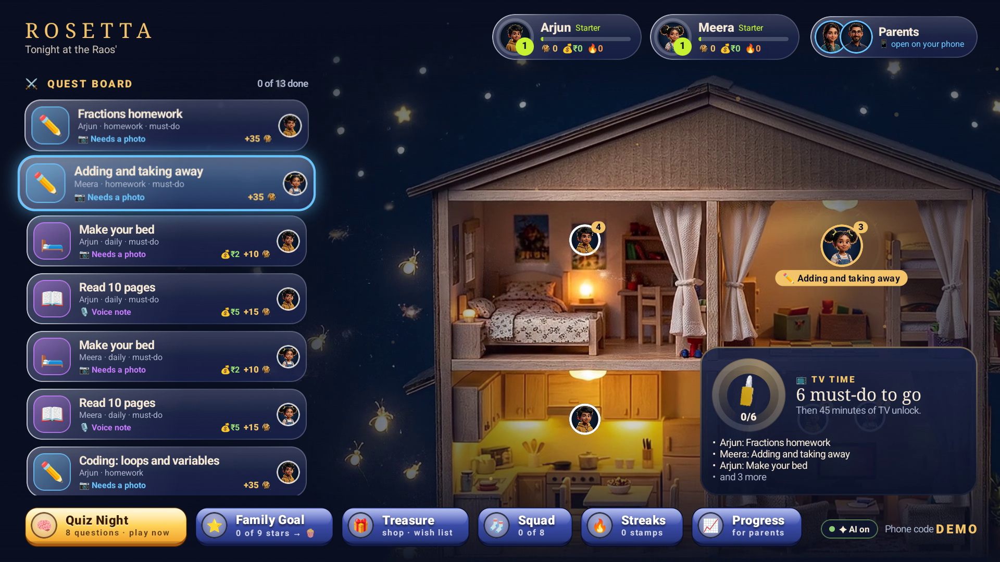
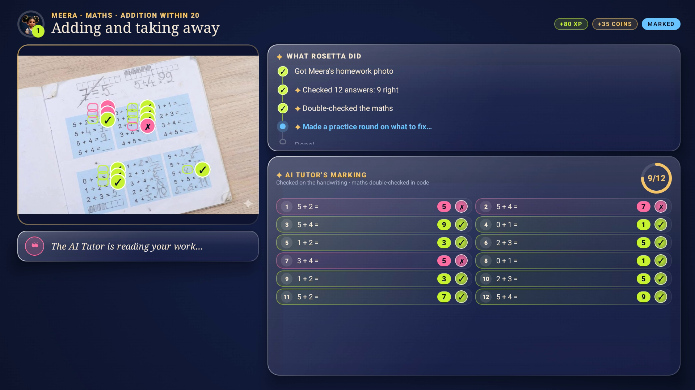
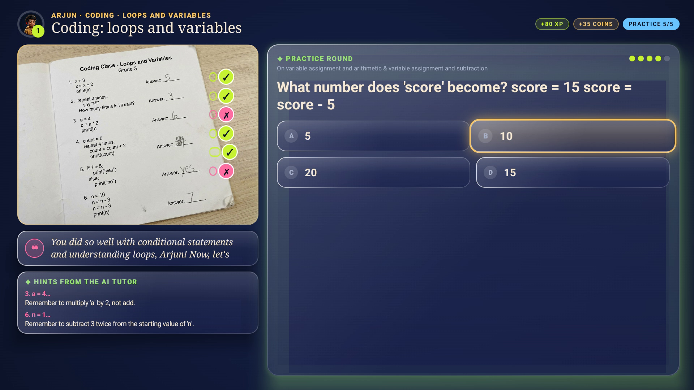
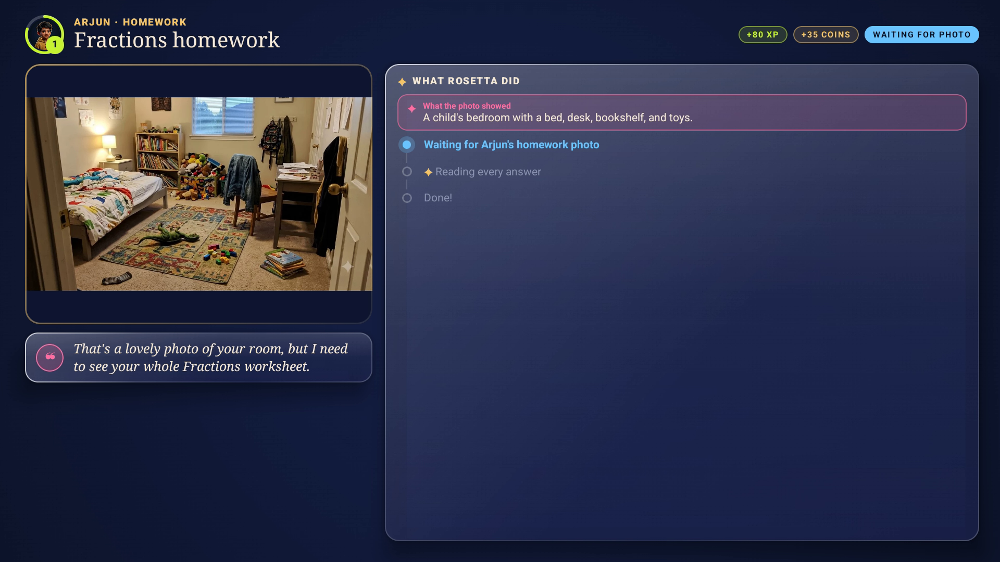
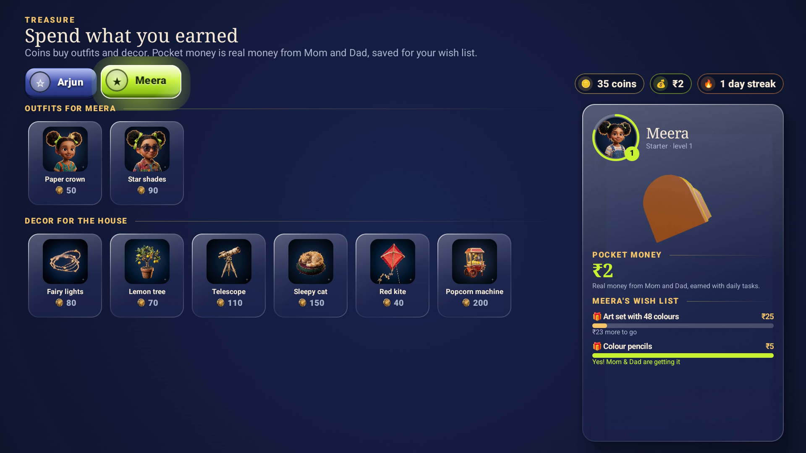
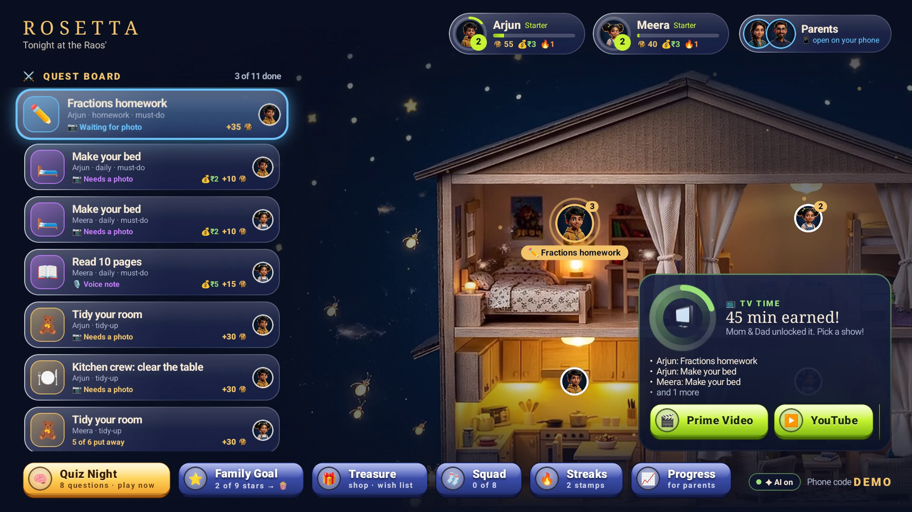
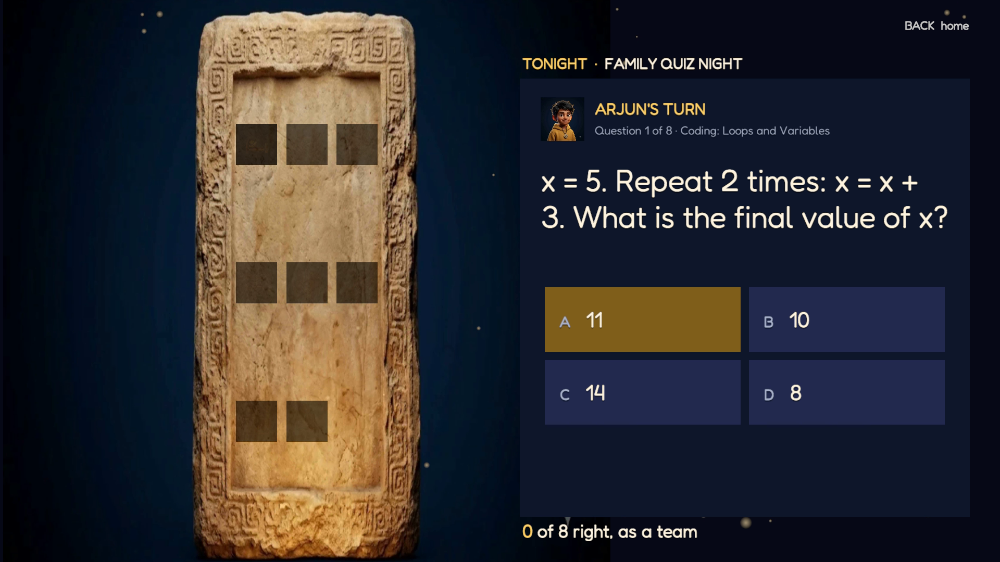
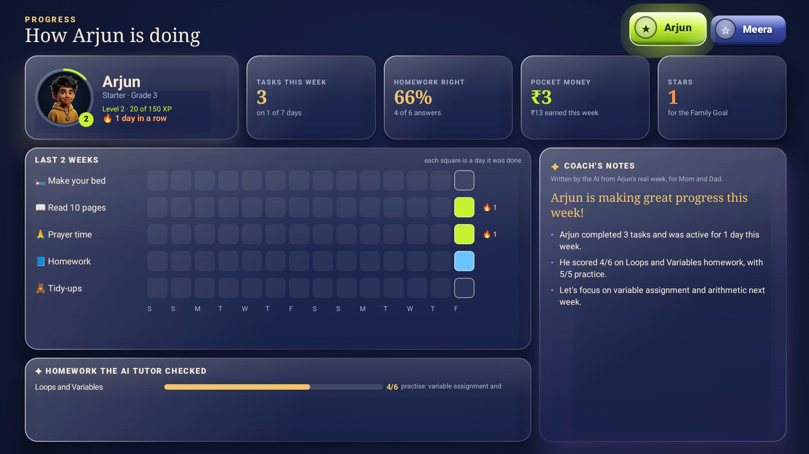
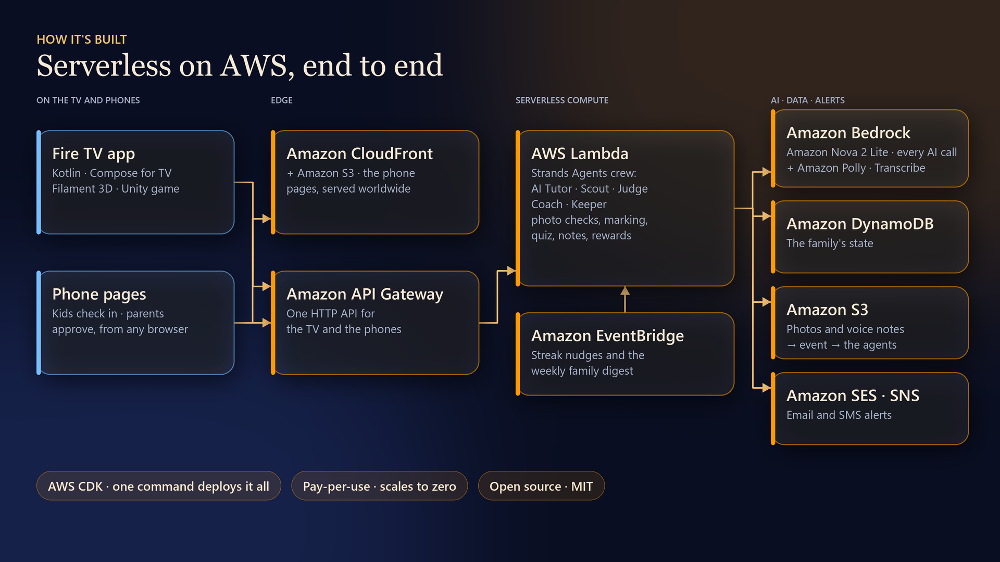

# Project Rosetta

**A Fire TV app where homework, chores and daily habits earn TV time and real pocket money, checked by an AI agent crew that runs serverless on AWS.**

Every evening, in millions of homes, the same two questions are asked in front of the same screen: *"Did you finish your homework?"* and *"Can I watch TV now?"* Rosetta turns the family TV into the place where those questions get answered fairly. Parents set the day from their phone. Kids check in from theirs. The TV shows the whole family how the day is going, an AI tutor marks homework honestly, rewards and real pocket money land for every finished task, and **TV time unlocks only when today's must-do tasks are done**.

> Built for the Amazon Developer **Build, Ship, Shape** hackathon · **Fire TV track** · **AWS Builder** and **Open Source** mini challenges.
> Open-source spin-off: [**compose-vision-overlay**](https://github.com/ashfaque-rifaye/compose-vision-overlay), a Compose for TV library that draws AI vision results.

| | |
|---|---|
| **Try the TV app** | Install page and APKs: **https://dr8w3l96syzm7.cloudfront.net/tv.html** |
| **Parent phone page** | https://dr8w3l96syzm7.cloudfront.net/parent.html?code=DEMO (demo PIN **2468**) |
| **Kid phone page** | https://dr8w3l96syzm7.cloudfront.net/kid.html?code=DEMO |
| **Friction log** | https://dr8w3l96syzm7.cloudfront.net/friction-log.html |
| **Demo video** | See the Devpost page (under 3 minutes) |



| ✦ AI Tutor marks a real workbook | ✦ Coding class, traced line by line | ✦ Honest about a wrong photo |
|---|---|---|
|  |  |  |

| Pocket money and wish list | TV time, unlocked | Family Quiz Night (Unity) | Progress and ✦ Coach's notes |
|---|---|---|---|
|  |  |  |  |

Screenshots are from the Android TV emulator configured as **Fire OS 16** (Android 16, API 36, 1080p) running against the live AWS stack.

---

## Built on AWS

AWS is the core of Rosetta. Everything behind the TV, from the moment a child's phone uploads a photo to the moment the marked homework appears on the TV, runs serverless on AWS in **one AWS CDK stack**.



```
 Kid's phone (any browser)              AWS us-east-1 · one AWS CDK stack                         Fire TV (native Kotlin app)
 ┌─────────────────────────┐ PUT photo ┌──────────────────────────────────────────────────────┐ poll ┌────────────────────────────┐
 │ kid.html (QR on the TV) │ ────────► │ Amazon S3  uploads/ (photos deleted after 1 day)     │ ◄─── │ Home · TV time · quests    │
 └─────────────────────────┘ or voice  │   └─ S3 event ─► AWS Lambda: Quest Master            │      │ Homework Check · Practice  │
 ┌─────────────────────────┐ HTTP API  │                 (Strands Agents SDK)                 │      │ Rewards · Treasure · Squad │
 │ parent.html (PWA)       │ ────────► │      ├ AI Tutor · Practice · Quizmaster · Coach      │      │ Progress · Parents (QR)    │
 │ PIN · approve · alerts  │           │      ├ Scout · Judge · Router (tidy-ups)             │      │ ─launch─► Unity Quiz Night │
 └─────────────────────────┘           │      └ Listener · Proof check · Keeper               │      └────────────────────────────┘
        ▲                              │ Amazon Bedrock ── Converse API, Amazon Nova 2 Lite   │
        │                              │ Amazon Polly (voice) · Amazon Transcribe (notes)     │
        │ Web Push · email · SMS       │ Amazon API Gateway ── AWS Lambda (the API)           │
        └───────────────────────────── │ Amazon DynamoDB ── one household document            │
                                       │ Amazon EventBridge ── streak nudges, weekly digest   │
                                       │ Amazon SES · Amazon SNS ── parent alerts             │
                                       │ Amazon CloudFront + S3 ── phone pages, TV downloads  │
                                       └──────────────────────────────────────────────────────┘
```

### AWS services, and exactly where they're used

| AWS service | What Rosetta uses it for | Code |
|---|---|---|
| **Strands Agents SDK** | *Quest Master* is a Strands agent: for every photo or voice note it chooses the specialist tools to run (`mark_homework`, `make_practice`, `scout_room`, `check_after`, `ask_parent`, `complete_quest`, `keeper_says`) and handles the edge cases (wrong photo, low confidence, an already-tidy room) | `agents/rosetta_agents/crew.py` |
| **Amazon Bedrock** (Converse API, **Amazon Nova 2 Lite**) | Every AI call in Rosetta. Every prompt and JSON schema is a Bedrock Converse tool spec with forced tool choice; Quest Master uses the Strands `BedrockModel`. Nova 2 Lite is small, fast and low-cost; a little **extended reasoning** is switched on only for marking homework, tracing code and judging before/after room photos. Nova's 0–1000 grounding boxes drive the Lost Things overlay and the marks on the child's handwriting | `agents/rosetta_agents/vision.py`, `tutor.py`, `crew.py` |
| **Amazon Polly** (generative voice *Kajal*) | The Keeper's voice: every line the TV speaks, parents' messages read aloud on the TV, and the clips bundled in the app. Repeating lines are voiced once and cached in S3 | `agents/rosetta_agents/speech.py`, `voice.py` |
| **Amazon Transcribe** | Kids' voice notes ("I read 11 pages of Matilda…"): transcribed straight from S3 with language identification (Indian and other English, Hindi), then summarised for the parents by Nova | `speech.py`, `handlers.py` |
| **AWS Lambda** | Three functions: the HTTP API, the agent crew (S3-triggered) and scheduled jobs | `agents/rosetta_agents/handlers.py` |
| **Amazon API Gateway** (HTTP API) | One API for the Fire TV app and both phone pages | `infra/lib/rosetta-stack.ts` |
| **Amazon S3** | Presigned uploads straight from the phone (photos and voice notes); **S3 event notifications** start the agent Lambda; lifecycle rules delete photos and transcripts after 1 day and keep memories 90 days; cached Polly clips | `store.py`, `voice.py`, `rosetta-stack.ts` |
| **Amazon DynamoDB** | One household document per family: kids, quests, habits, rewards, pocket money, wish list, TV time, memories, history | `agents/rosetta_agents/store.py` |
| **Amazon EventBridge** | Daily habit quests, the evening streak nudge and the weekly family digest | `rosetta-stack.ts`, `handlers.scheduled` |
| **Amazon SES** · **Amazon SNS** | Parent alerts by email and SMS (alongside Web Push) | `agents/rosetta_agents/notify.py` |
| **Amazon CloudFront** | HTTPS phone pages (API URL injected at deploy time), the TV install page and the APK downloads | `rosetta-stack.ts` |
| **AWS CDK** (TypeScript) | The whole stack in one command: pay-per-use, scales to zero | `infra/` |
| **AWS IAM** | Each Lambda role gets only the bucket, table, Bedrock, Polly, Transcribe and email/SMS actions it needs | `rosetta-stack.ts` |

**Why this architecture.** A photo upload is the trigger, so the agent run is a plain **S3 event → Lambda**: no queue to manage and no servers idling between homework sessions. DynamoDB holds one document per family, which is what the TV polls once a second. The phones never touch AWS credentials: they upload with presigned URLs and talk to the HTTP API.

**Built with an agentic workflow.** The app, the agent crew and the CDK stack were developed with **Claude Code** as a pair programmer, and the crew itself is an agent architecture (a Strands coordinator agent over specialist tools).

### The agent crew

Kids never see agent names: on screen it's a plain "✦ What Rosetta did" step list. On the server (`agents/rosetta_agents/`):

| Agent | Job |
|---|---|
| **Quest Master** (`crew.py`, Strands agent) | Decides which specialists to call for each photo or voice note, and when to ask a parent instead |
| **AI Tutor** (`tutor.py`) | Marks homework on the child's own handwriting; traces code for coding class; writes practice and Quiz Night questions |
| **Scout** / **Judge** (`vision.py`) | Finds what's out of place in a room photo, with boxes; compares before and after |
| **Listener** (`speech.transcribe` + `vision.listen`) | Amazon Transcribe hears the voice note; Nova summarises it and says whether it's really about the task |
| **Proof check** (`vision.check_proof`) | Says honestly whether a photo shows the task done, and what it actually shows |
| **Router** | Sends low-confidence verdicts to a parent instead of deciding |
| **Coach** (`vision.digest`) | Writes the Coach's notes from real history only |
| **Keeper** (`voice.py`, `speech.py`) | The friendly voice that speaks to the child on the TV (Amazon Polly) |

Every specialist is one Bedrock call with a forced JSON schema that must also say **what it actually saw or heard**, which is what makes Rosetta's honest replies possible.

**Trust layer.** `mathcheck.py` computes exact answers with Python fractions and overrides the model's verdict on arithmetic ("the model reads, the code decides"). It also recognises classic slips ("you added the bottom numbers too") for precise hints. On our test sheets the model alone agreed with the true marking on 10 of 11 answers; with the check, 11 of 11.

**One model call.** Every Bedrock call goes through one function (`vision._converse`): forced tool choice, optional reasoning, and a retry without reasoning if a long think ends without an answer. The model is one setting (`ROSETTA_MODEL_ID`, or `npx cdk deploy -c modelId=…`), so moving to a larger Bedrock model is a redeploy, not a rewrite.

**Measured on our sample sheets** (`assets/homework/*.jpg`, `assets/demo/coding_homework.jpg`) with Nova 2 Lite: fractions 6/6, Grade 1 numbers 5/5 and the coding class 6/6 marked the same as the answer key, in 12–18 s per page.

---

## What it does

| Feature | What it does |
|---|---|
| **A living home** | Home is an animated dollhouse; the camera glides to each child's room as you browse the Quest Board. Each child's card opens their Progress; a Parents button shows the QR for the parent page. |
| **TV time, earned** | A TV Time portal shows "6 must-do to go". When the must-dos are done (or a parent taps *Unlock TV time now* on their phone) it bursts open and Rosetta launches Prime Video, YouTube or Netflix, counting the minutes. |
| **✦ AI Tutor** | Snap a worksheet with any phone; in about 15 seconds every answer is marked on the child's handwriting with a score ring and a hint per mistake, **never the answer**. Coding class works too: programs are traced line by line. |
| **✦ Practice** | A short round on exactly the skills that slipped: easy reasoning questions for the child's grade, not "1 + 1". |
| **✦ Honest photo checks** | Send the wrong photo and Rosetta says what it sees. Tidy-ups turn each out-of-place item into a collectible Lost Thing, and the after photo is checked again ("5 of 6 back home"). |
| **Daily habits and memories** | *Make your bed*, *read 10 pages*, *prayer time*: check in with a tick, a note, a photo or a **voice note** (✦ transcribed and summarised). Notes and voice notes are kept 90 days as memories parents can replay. Every habit has its own streak. |
| **Rewards for every child** | XP, levels, coins, stamps and a star toward the **Family Goal**; nine stars unlock **Movie Night**. Coins buy outfits and house decor in Treasure. |
| **Real pocket money** | Parents choose what each task pays. Kids save toward a **wish list**; when there's enough they ask from their phone, a parent taps **Yes**, and the TV updates the balance live. |
| **Family Quiz Night** | A co-op quiz in a **Unity 6** 3D scene (or natively), with reasoning questions written for each child's class, subjects and upcoming tests. Siblings take turns; nobody is ranked. |
| **Progress and ✦ Coach's notes** | Per child: a 14-day habit calendar, homework accuracy, pocket money, stars, and notes the AI writes from real activity only. |
| **Parents in control** | A phone page, no app to install: PIN sign-in, push/email/SMS alerts, approvals, daily tasks, learning profiles, pocket money, wish lists, TV time, and a Fire TV parental-controls guide. |

The **✦** sparkle marks everything the AI does, on the TV and on the phones. Nothing on screen is sample data: every number comes from the family's real history on the server.

---

## Try it

### Option A: install the TV app from AWS (no build needed)
Open **https://dr8w3l96syzm7.cloudfront.net/tv.html**. It hosts the TV app (already pointed at the live AWS stack and the public **DEMO** family) and the Unity Quiz Night companion, with step-by-step install instructions for:
- **Fire TV** (Fire OS): with the free *Downloader* app, or `adb connect <tv-ip>:5555` then `adb install`.
- **The Android TV emulator** (the hackathon FAQ accepts it): Android Studio → SDK Manager → `system-images;android-36;android-tv;x86_64` (Fire OS 16 = Android 16), create a *TV 1080p* device, then `adb install rosetta-tv-demo.apk`.

### Option B: build it yourself
```bash
cd tv-app
./gradlew installDebug -ProsettaApiUrl=https://jlgtsqwtzl.execute-api.us-east-1.amazonaws.com \
                       -ProsettaWebUrl=https://dr8w3l96syzm7.cloudfront.net -ProsettaCode=DEMO
```

### A five-minute test script (DEMO family: Mom, Dad, Arjun in Grade 3, Meera in Grade 1)
1. **TV:** Home opens on the living house. Scroll the Quest Board with the D-pad; the camera follows. Press **UP** for Arjun's and Meera's Progress, or the **Parents** button for the QR code.
2. **Parent phone:** open the parent page, sign in as Mom with PIN **2468**. Tap **Unlock TV time now** and watch the TV portal open; **Lock it again** to reset.
3. **Homework:** on the TV open *Fractions homework* (Arjun). On the kid page pick Arjun and snap any worksheet (or show `assets/homework/arjun_fractions.jpg` on a laptop screen). In about 15 seconds the AI Tutor marks it on the TV.
4. **Honesty:** send a photo of anything else; Rosetta says what it actually sees.
5. **Daily task:** on the kid page, record a voice note for *Read 10 pages*; it's summarised and kept as a memory on the parent page.
6. **Pocket money:** on the parent page add a cheap wish; once the child has saved enough, they ask from the kid page and Mom approves. The TV's **Treasure** screen updates.
7. **Quiz Night:** bottom bar → *Quiz Night*. Rosetta writes 8 questions for the two children and opens the 3D game (if the Quiz Night APK is installed).

Emulator keys: arrows = D-pad, Enter = select, Esc = Back. **Start the family over** is at the bottom of the parent page.

### Option C: offline demo mode (no cloud at all)
```bash
cd tv-app && ./gradlew installDebug
```
The TV runs its on-device household engine (badge **AI offline**). **MENU** sends the bundled photo for the open quest (the marking replayed is real model output recorded on that photo).

### Deploy your own AWS backend
Prerequisites: an AWS account (us-east-1) with Amazon Bedrock access to **Amazon Nova 2 Lite** (Amazon Polly and Amazon Transcribe need no setup), Node 20+, Python 3.12+ and [uv](https://docs.astral.sh/uv/).
```bash
python assets/build_assets.py              # copies art into the TV app and web/
python agents/build_lambda.py              # Linux bundle for Lambda (uv resolves wheels for the Lambda platform)
cd infra && npm install && npx cdk deploy
curl -X POST <ApiUrl>/household/DEMO/reset
```
The stack prints `ApiUrl` and `WebUrl`; pass them to the TV build with `-ProsettaApiUrl` / `-ProsettaWebUrl`. Put APKs in `dist/downloads/` before deploying to publish them on the install page.

### Family Quiz Night in Unity (optional)
The TV app opens Quiz Night in the companion Unity app when it's installed, and plays it natively otherwise. The scene is built entirely from C#, so it builds headlessly:
```bash
bash arena-unity/sync.sh --build     # mirrors the source into a Unity 6 project and builds Builds/RosettaArena.apk
```
The APK targets ARMv7 and ARM64 (Fire TV hardware) and x86_64 (emulators). BACK returns home with the answers.

### Tests
```bash
python -m unittest discover -s agents/tests     # 45 offline tests: API, habits, voice notes, TV time, wish list, marking, quiz (models stubbed)
```

---

## Fire TV details
- **Kotlin + Jetpack Compose for TV** (`androidx.tv:tv-material`), D-pad first, minSdk 25 (Fire OS 6+).
- Every screen is drawn on a **1440 × 810 canvas** scaled to the panel, so 720p, 1080p (960 × 540 dp) and 4K Fire TVs show the same picture.
- **Real-time 3D** rewards (coins, chest, padlock, TV, trophy, stars) with Filament via SceneView, one shared engine for the whole app.
- **Media3** plays the intro film and the living-house loop.
- Fire TV can't let an app lock other apps, so earned TV time is honoured inside Rosetta (it launches the streaming app and counts minutes) and parents are guided to Fire TV's own parental controls. An Amazon Kids "earn time" API is our top feature request.

## Privacy and kids
- No kid accounts: a household is parent-managed; kids are a first name.
- Photos are deleted automatically after one day (S3 lifecycle). Notes and voice notes are kept 90 days as memories, then deleted.
- The Keeper is prompted never to shame, mock or comment on a child's character, and to praise only what actually went well.
- Low-confidence verdicts go to a parent instead of auto-deciding. Parent actions need the household PIN.
- Co-op only: siblings are never ranked. Rewards are earned, never random.

## Repo map
| Path | |
|---|---|
| `tv-app/` | Fire TV app (Kotlin, Compose for TV) · `tv-app/vision-overlay/` the original of the open-source library |
| `arena-unity/` | Family Quiz Night companion app (Unity 6, URP, C#) |
| `agents/` | The agent crew (Python, Strands Agents, Bedrock Converse) and 45 offline tests |
| `infra/` | The AWS CDK stack (TypeScript) |
| `web/` | Kid and parent phone pages, the TV install page and the friction log page |
| `assets/` | Art, worksheets, the intro, and the demo-video tooling (`assets/demo/`) |
| `docs/` | Screenshots |
| `SUBMISSION.md` · `FEEDBACK.md` · `FRICTION_LOG.md` · `CREDITS.md` | Devpost text, developer feedback, friction log, asset credits |

## License
MIT. See [LICENSE](LICENSE). AI-generated artwork and media: see [CREDITS.md](CREDITS.md).
