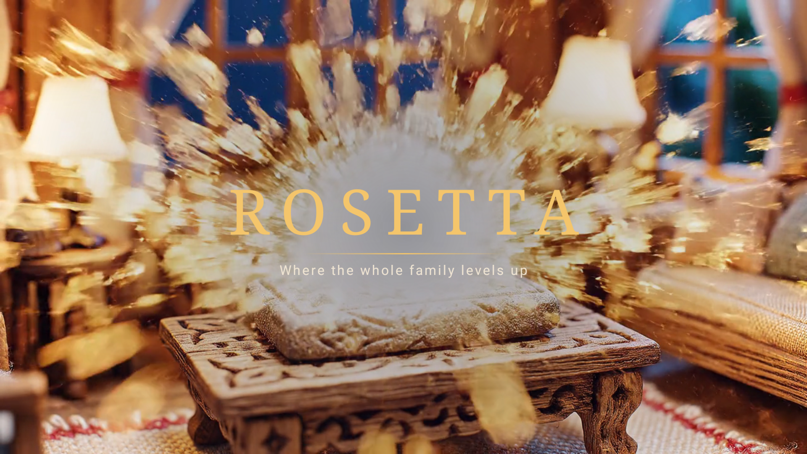
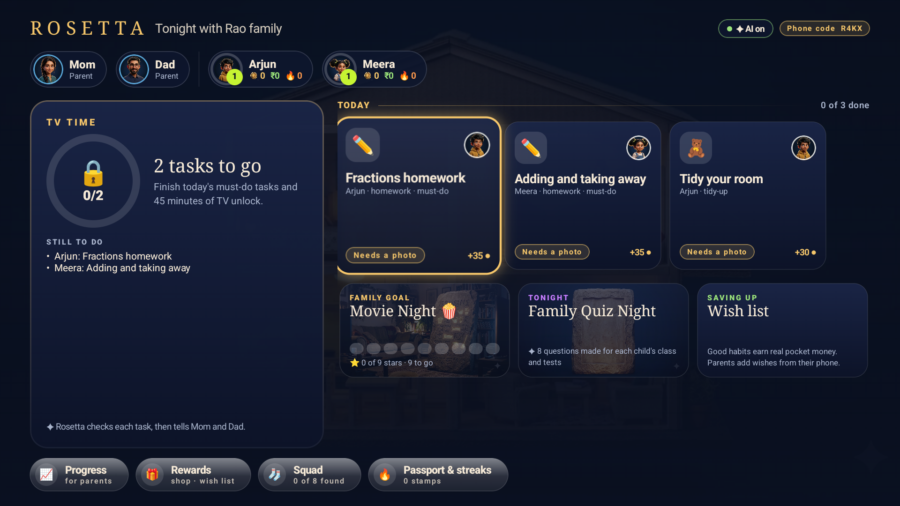
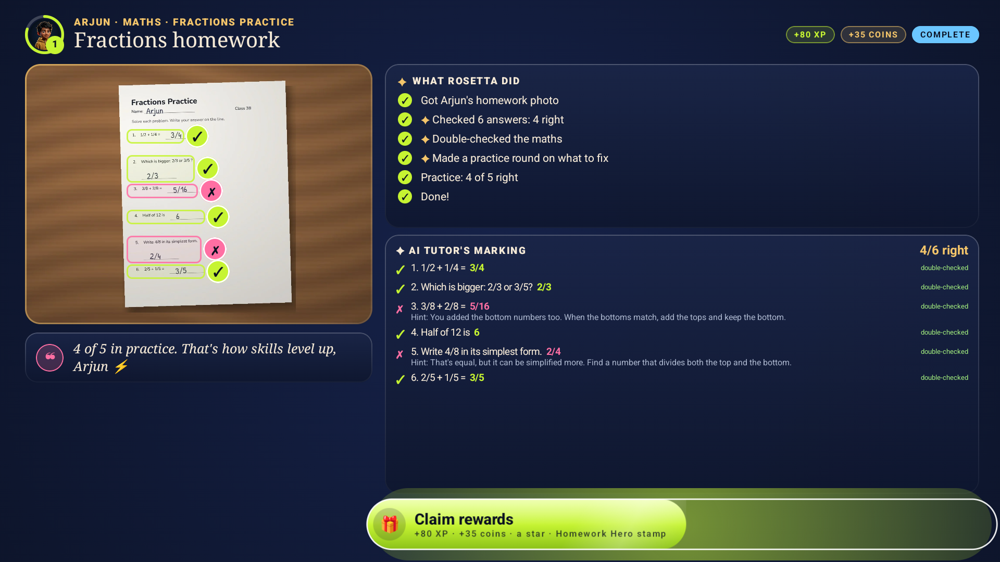
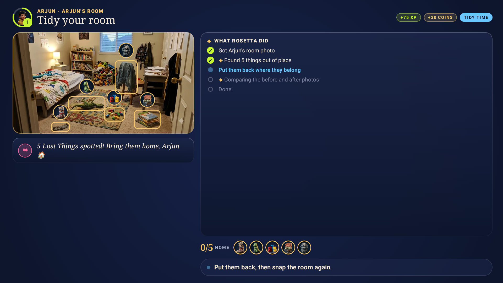
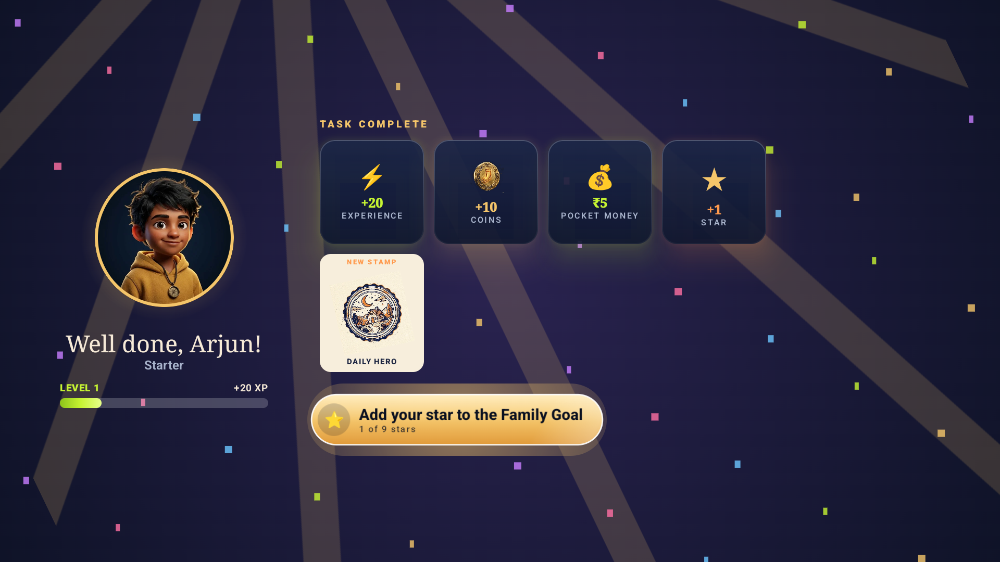
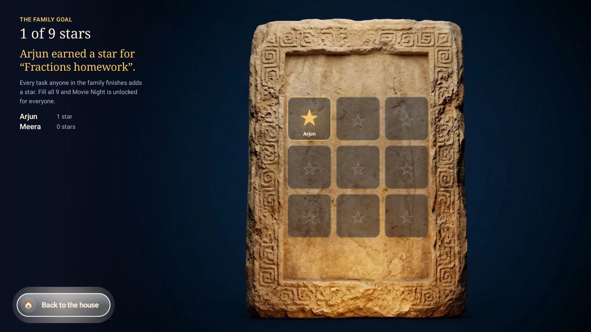
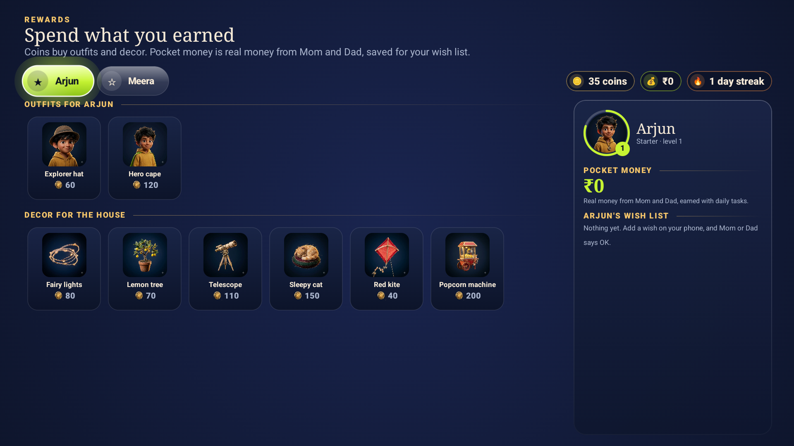

# Project Rosetta

**The Fire TV that turns homework and chores into a family adventure, with an AI tutor that never gives the answer away.**

Parents set the day: homework, a tidy-up, and daily tasks like *make your bed*, *read 10 pages* or *prayer time*. Kids
check in from any phone with a tick, a note, a voice note or a photo, and the TV shows the whole family how the day is
going. ✦ AI checks the work honestly: the **AI Tutor** marks a worksheet answer by answer (arithmetic double-checked in
code, a hint for each mistake, never the answer), Rosetta tells a child plainly when a photo shows something else, and a
voice note only counts if it's really about the task. Finished tasks pay real pocket money toward a wish list, add a
star to the Family Goal (nine stars unlock Movie Night), and grow streaks. **TV time unlocks only when today's must-do
tasks are done.** Parents get phone alerts, approve what needs a grown-up, and look back on their children's voice
notes as memories.

> Built for the Amazon Developer **Build, Ship, Shape** hackathon · **Fire TV track** · AWS Builder + Open Source mini challenges.
> Open-source spin-off: [**compose-vision-overlay**](https://github.com/ashfaque-rifaye/compose-vision-overlay), the Compose for TV library that draws AI vision results.

All screenshots are from the Android TV emulator configured as **Fire OS 16** (Android 16, API 36, 1080p, 320 dpi).

| Intro (Veo + Lyria) | Home: the family and TV time | Homework, marked by the ✦ AI Tutor |
|---|---|---|
|  |  |  |

| Room check | A daily task pays pocket money | Family Goal | Rewards and wish list |
|---|---|---|---|
|  |  |  |  |

## What's inside

| Feature | What it does |
|---|---|
| **TV time, earned** | Home shows today's deal: *2 tasks to go*. When every must-do task is done (and a parent says OK, if they asked to), TV time unlocks and Rosetta opens Prime Video, YouTube or Netflix, counting the minutes used. |
| **Daily tasks + memories** | Parents add recurring tasks with presets. Kids check in with a tick, a note, a voice note (✦ transcribed and summarised) or a photo (✦ checked). Notes and voice notes are kept 90 days as memories parents can replay. |
| **Streaks** | A day streak per child and a streak per daily task, from the server's history only. |
| **Homework Check** | Snap a worksheet; the AI Tutor marks each answer on the child's handwriting. Arithmetic is verified in code (`mathcheck.py`): the model reads, code decides. Wrong answers get a method hint, never the answer. Then a practice round on exactly the skills that slipped. |
| **Honest photo checks** | Every check reports what it actually saw. A worksheet sent for "tidy your room" is called out; a tidy room is accepted as tidy. Nothing is ever made up. |
| **Family Quiz Night** | 8 questions, moderate difficulty, written for each child's class, subjects and coming tests (set by parents); siblings take turns. Co-op only. Plays in a Unity 6 scene or natively. |
| **Pocket money + wish list** | Tasks can pay real money set by parents. Parents add wishes (an Amazon link, say); when a child has saved enough they ask from their phone, and a parent approves. Coins buy outfits and house decor. |
| **Family Goal → Movie Night** | Every finished task adds a star; nine unlock Movie Night. |
| **Progress, for parents** | Per child: a 14-day habit calendar, homework accuracy, pocket money, and ✦ Coach's notes the AI writes from real activity once there is some. |
| **Parents in control** | A phone page (no app to install): PIN sign-in, push alerts, approvals, today at a glance, memories, daily tasks, learning profile, wish list, TV settings and a Fire TV parental-controls guide. |
| **The intro** | An 8-second film made with Veo 3.1 and an original Lyria score, with the ROSETTA wordmark animated in Compose. |

The **✦** sparkle marks everything the AI does, on the TV and on the phones.

### The agent crew (behind the scenes)
Kids never see agent names; this is how the work is split on the server (`agents/rosetta_agents/`):

| Agent | Job |
|---|---|
| Quest Master (`crew.py`, Strands) | Decides which specialist to call for each photo, and when to ask a parent |
| AI Tutor (`tutor.py`) | Marks homework; writes practice and Family Quiz Night questions |
| Scout / Judge (`vision.py`) | Finds what's out of place in a room photo; compares before and after |
| Listener (`vision.listen`) | Transcribes and summarises a voice note, and says whether it's about the task |
| Proof check (`vision.check_proof`) | Says honestly whether a photo shows the task done |
| Router | Sends low-confidence verdicts to a parent instead of deciding |
| Coach (`vision.digest`) | Writes the Coach's notes from real history |
| Keeper (`voice.py`) | Says it out loud in a warm Gemini TTS voice |

## How it works

```
 Kid's phone (any browser)            AWS us-east-1 (AWS CDK)                                Fire TV (native Kotlin app)
 ┌───────────────────────┐ PUT photo ┌───────────────────────────────────────────────────┐ poll ┌──────────────────────────┐
 │ kid.html (QR on TV)   │ ────────► │ S3 uploads/ (deleted after 1 day)                 │ ◄─── │ Home · TV time · tasks   │
 └───────────────────────┘           │   └─event─► Agent Lambda: Quest Master            │      │ Homework Check · Practice│
 ┌───────────────────────┐ HTTP API  │              (Strands Agents SDK)                 │      │ Homework · daily tasks   │
 │ parent.html (PWA)     │ ────────► │      ├ Tutor / Coach / Quizmaster (homework)      │      │ Keeper voice · messages  │
 │ PIN · approve · alerts│           │      ├ Scout / Judge / Router (tidy-ups)          │      │ ─launch─► Unity Quiz     │
 └───────────────────────┘           │      └ Listener · Keeper (voice in and out)       │      │           Night (answers │
                                     │ API Lambda ── DynamoDB (one household document)   │      │           sync back)     │
                                     │ EventBridge ── nudges + weekly digest             │      └──────────────────────────┘
                                     │ SES · SNS · Web Push ── parent alerts             │
                                     │ CloudFront ── phone pages                         │
                                     └──────────────────────┬────────────────────────────┘
                                         keyless (Workload  │  model calls: vision, text, voice
                                         Identity Federation)▼
                                     Gemini on Vertex AI (today) · Amazon Bedrock Nova (one flag)
```

- **Fire TV app** (`tv-app/`): Kotlin, Jetpack Compose for TV (`androidx.tv:tv-material`), D-pad first, runs on Fire OS (minSdk 25). Every screen is drawn on a 1440 × 810 canvas scaled to the display, so 720p, 1080p and 4K Fire TVs show the same picture.
- **Agent crew** (`agents/`): Python, [Strands Agents](https://strandsagents.com). Quest Master decides which specialist to call; each specialist is one model call with images and a forced JSON schema.
- **Models**: provider-agnostic. Every call goes through `vision._converse`; prompts and schemas are written once as Bedrock Converse tool specs and reused as Gemini response schemas (`agents/rosetta_agents/gemini.py`). Today the crew runs on **Gemini 2.5 Flash via Google Vertex AI** (cost), with **Gemini TTS** for the Keeper's voice; `npx cdk deploy -c aiProvider=bedrock` switches back to **Amazon Bedrock (Nova Pro)**.
- **No keys**: the Lambdas sign in to Vertex AI with Workload Identity Federation (Google trusts this stack's AWS roles); `agents/gcp_wif.json` holds no secrets.
- **Infrastructure** (`infra/`): AWS CDK (TypeScript): S3, DynamoDB, Lambda ×3, API Gateway HTTP API, EventBridge, CloudFront.
- **Phone pages** (`web/`): plain HTML/JS. The kid scans the QR on the TV, picks their name and checks in; photos are shrunk on the phone and voice notes recorded in the browser, both uploaded straight to S3.

## Run it

### 1. Try it in ten minutes (live backend already deployed)
1. **Fire TV emulator.** In Android Studio's SDK Manager install `system-images;android-36;android-tv;x86_64` (Fire OS 16 is Android 16 / API 36) and create a TV 1080p device. The hackathon FAQ accepts the Android TV emulator. On a real Fire TV (or any Android TV / Google TV), turn on *Developer options → ADB debugging* and run `adb connect <tv-ip>:5555`.
2. **Install the TV app**, pointed at the live stack:
   ```bash
   cd tv-app && ./gradlew installDebug -ProsettaApiUrl=https://jlgtsqwtzl.execute-api.us-east-1.amazonaws.com -ProsettaWebUrl=https://dr8w3l96syzm7.cloudfront.net
   ```
   Optional: the Unity Quiz Night, `adb install -r RosettaArena.apk` (build it with step 4).
3. **The demo household** is the Rao family (Mom, Dad, Arjun in Grade 3, Meera in Grade 1), starting from zero: no fake progress anywhere.
4. **Parent phone:** `https://dr8w3l96syzm7.cloudfront.net/parent.html?code=R4KX`, sign in as Mom or Dad with demo PIN **2468**, turn on alerts, and add a daily task (try the *Read 10 pages* preset, voice note).
5. **Kid phone:** scan the QR on the TV (or open `https://dr8w3l96syzm7.cloudfront.net/kid.html?code=R4KX`), pick a name, and check in. Open *Fractions homework* on the TV and photograph a worksheet (try `assets/homework/arjun_fractions.jpg` on a laptop screen): in about 15 s the AI Tutor marks it. Finish the must-do tasks and TV time unlocks. **Start the family over** is at the bottom of the parent page.

Emulator keys: arrows = D-pad, Enter = select, Esc = Back.

### 2. Offline demo mode (no cloud at all)
```bash
cd tv-app && ./gradlew installDebug
```
The TV runs its on-device household engine (badge **AI offline**). Hidden developer keys stand in for the phone: **MENU** sends the bundled photo for the open quest (the marking replayed is real model output recorded on that photo) and **FAST-FORWARD** sends a sibling emote (`adb shell input keyevent KEYCODE_MENU`).

### 3. Deploy your own backend
Prerequisites: an AWS account (us-east-1), Node 20+, Python 3.12+, [uv](https://docs.astral.sh/uv/), and a Google Cloud project with the Vertex AI API enabled (or Bedrock access to Amazon Nova Pro, then add `-c aiProvider=bedrock`).

```bash
python assets/build_assets.py            # copies art into the TV app and web/
python agents/build_lambda.py            # Linux bundle for Lambda (uv resolves wheels for the Lambda platform)
cd infra && npm install && npx cdk deploy
curl -X POST <ApiUrl>/household/R4KX/reset
```
Keyless Vertex AI access for the Lambdas (once, after the first deploy so the roles exist):
```bash
gcloud iam service-accounts create rosetta-agents
gcloud projects add-iam-policy-binding <project> --member serviceAccount:rosetta-agents@<project>.iam.gserviceaccount.com --role roles/aiplatform.user
gcloud iam workload-identity-pools create rosetta-aws --location global
gcloud iam workload-identity-pools providers create-aws aws-rosetta --location global --workload-identity-pool rosetta-aws --account-id <aws-account> --attribute-mapping="google.subject=assertion.userid,attribute.aws_role=assertion.arn.contains('assumed-role') ? assertion.arn.extract('{account_arn}assumed-role/') + 'assumed-role/' + assertion.arn.extract('assumed-role/{role_name}/') : assertion.arn"
# for each of the AgentCrewFn, ApiFn and ScheduledFn roles:
gcloud iam service-accounts add-iam-policy-binding rosetta-agents@<project>.iam.gserviceaccount.com --role roles/iam.workloadIdentityUser --member "principalSet://iam.googleapis.com/projects/<number>/locations/global/workloadIdentityPools/rosetta-aws/attribute.aws_role/arn:aws:sts::<aws-account>:assumed-role/<role-name>"
gcloud iam workload-identity-pools create-cred-config projects/<number>/locations/global/workloadIdentityPools/rosetta-aws/providers/aws-rosetta --service-account rosetta-agents@<project>.iam.gserviceaccount.com --aws --output-file agents/gcp_wif.json
```
Then rebuild the bundle and deploy again. `python agents/warm_voice.py` pre-voices the repeating Keeper lines (Gemini TTS has a small per-minute quota).

### 4. Family Quiz Night in Unity (optional)
The TV app opens Family Quiz Night in the companion Unity app when it is installed, and plays it natively otherwise. The source lives in `arena-unity/`; the scene is built entirely from code, so it builds headlessly.
```bash
bash arena-unity/sync.sh --build     # mirrors the source into a Unity 6 project and builds Builds/RosettaArena.apk
```
The APK targets ARM64 (Fire TV hardware) and x86_64 (emulators). BACK returns home with the answers.

### 5. Tests
```bash
python -m unittest discover -s agents/tests     # 45 offline tests: API, habits, voice notes, TV time, wish list, marking, quiz (models stubbed)
```

## AWS integrations

| Service | What Rosetta uses it for | Code |
|---|---|---|
| Strands Agents SDK | Quest Master agent choosing tools per photo: mark_homework, make_practice, scout_room, check_after, ask_parent, complete_quest, keeper_says | `agents/rosetta_agents/crew.py` |
| AWS Lambda | API, the agent crew (S3-triggered) and scheduled jobs | `agents/rosetta_agents/handlers.py`, `infra/lib/rosetta-stack.ts` |
| Amazon S3 | Photo and voice-note uploads (presigned PUT, 1-day lifecycle), memories (90 days), voice clips, web hosting | `store.py`, `voice.py`, `rosetta-stack.ts` |
| Amazon DynamoDB | Household document (tasks, habits, history, memories, wish list, TV time, quiz, feed) | `store.py` |
| Amazon API Gateway (HTTP API) | TV + phone API | `rosetta-stack.ts` |
| Amazon EventBridge | Daily tasks, evening streak nudge, Coach's notes | `rosetta-stack.ts`, `handlers.scheduled` |
| Amazon SES / Amazon SNS / Web Push | Parent alerts by email, SMS (urgent only) and phone push (VAPID) | `notify.py` |
| Amazon CloudFront | HTTPS phone pages with the API URL injected | `rosetta-stack.ts` |
| AWS CDK | One-command infrastructure | `infra/` |
| Amazon Bedrock (Nova Pro) | Supported model provider (`-c aiProvider=bedrock`); every prompt and schema is a Bedrock Converse tool spec | `vision.py`, `tutor.py` |

## Privacy and kids
- No kid accounts: a household is parent-managed; kids are a first name.
- Photos are deleted automatically after one day (S3 lifecycle). Daily-task notes and voice notes are kept 90 days as memories for parents, then deleted.
- The Keeper is prompted never to shame, mock, or comment on a child's character, and to praise only what actually went well.
- Low-confidence verdicts go to a parent instead of auto-deciding. Parent actions need the household PIN.
- Co-op only: siblings are never ranked. Rewards are earned, never random.

## Repo map
| Path | |
|---|---|
| `tv-app/` | Fire TV app (Kotlin, Compose for TV) · `tv-app/vision-overlay/` the original of the open-source library |
| `arena-unity/` | Family Quiz Night companion app (Unity 6, URP, C#) |
| `agents/` | Agent crew (Python, Strands) + offline tests · `gemini.py` Vertex AI · `voice.py` Keeper voice |
| `infra/` | AWS CDK stack |
| `web/` | Kid and parent phone pages |
| `assets/flow/` | Original art generated in Google Flow (watermarks untouched) · `assets/voice/` bundled Keeper voice generator · `assets/intro/` Veo + Lyria intro |
| `assets/homework/` | Demo worksheets rendered from code, their true answers, and recorded model outputs replayed offline |
| `PROJECT_ROSETTA.md` | Product spec, prior-art search, hackathon compliance map |
| `SUBMISSION.md` · `FEEDBACK.md` · `FRICTION_LOG.md` · `CREDITS.md` | Devpost text, developer feedback, friction log, asset credits |

## License
MIT. See [LICENSE](LICENSE). AI-generated artwork: see [CREDITS.md](CREDITS.md).
